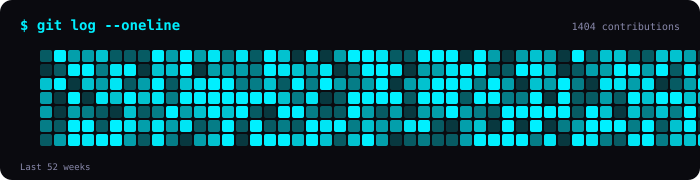

# ⚡ Sebastian Rodrigo Rabanal Francia

<!-- Profile Card SVG -->

<!-- Languages Card -->

<!-- Activity Card -->

---

## 🚀 Featured Work

| Proyecto | Descripción | Tecnologías |
|----------|-------------|-------------|
| **NASA Space Apps Challenge 2025** | Interfaz interactiva front-end para hackathon espacial | `HTML` `CSS` `JavaScript` |
| **Torneo Peruano de Programación** | Competencia de algoritmos bajo presión | `Algoritmos` `Problem Solving` |
| **CTIC UNI** | Ciencia de Datos, Ethical Hacking, Power BI | `Power BI` `SQL Server` `Ethical Hacking` |
| **Netzun** | Desarrollo web full-stack completo | `HTML` `CSS` `JavaScript` `Python` `PostgreSQL` `Git` |

---

## 🛠️ Full Stack

| Categoría | Tecnologías |
|-----------|-------------|
| **Lenguajes** | Python, JavaScript, Rust, HTML, CSS, SQL |
| **Frontend** | React, Ember, HTML, CSS |
| **Databases** | PostgreSQL, MySQL, SQL Server |
| **Cloud & Data** | AWS Glue, LakeHouse, Athena |
| **ERP** | Odoo |
| **IA & Agentes** | OpenCode, ClaudeCode, RAGs, MCP, LLMs |
| **Tools** | Git/GitHub, Docker |

---

## 🎯 Soft Skills

`Innovación` · `Creatividad` · `Disciplina` · `Autonomía` · `Adaptabilidad`

---

## 📫 Connect

---

  ⚡ Powered by <b>CoreCodev Auto-Builder</b> · Updated daily via GitHub Actions

